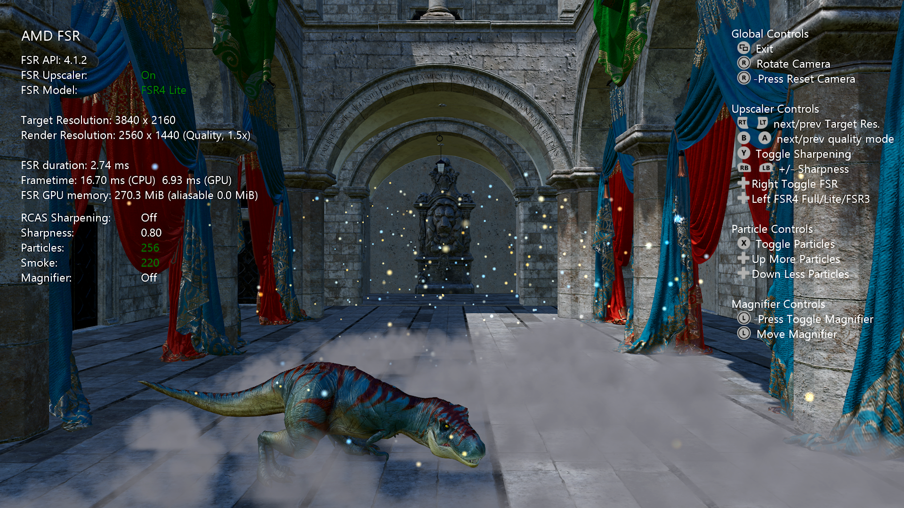

<!-----
---
page_type: sample
languages:
- cpp
products:
- gdk
urlFragment: "amdfsr"
extendedZipContent:
- path: LICENSE
  target: LICENSE
- path: Kits
  target: Kits
- path: Media
  target: Media
description: "This sample demonstrates AMD FSR� Upscaling 4 on the Microsoft GDK, integrated through the unified AMD FSR� SDK."
---
----->

# AMD FSR™ Upscaling 4 — GDK Sample

*This sample requires the Microsoft Game Development Kit October 2025 or later.*



# Description

This sample demonstrates **AMD FSR™ Upscaling 4** on the Microsoft GDK, integrated through the unified **AMD FSR™ SDK**.

| Technique | Version in this sample | Variants |
|-----------|------------------------|----------|
| AMD FSR™ Upscaling 4 | **4.1.2** | Full and Lite |

# Table of contents

- [Building the sample](#building-the-sample)
- [Using the sample](#using-the-sample)
- [Sample configuration](#sample-configuration)
- [AMD FSR™ Upscaling 4](#amd-fsr-upscaling-4)
  - [Scaling modes](#scaling-modes)
  - [Input resources](#input-resources)
  - [Integration](#integration--amd-fsr-upscaling-4)
  - [Memory usage](#memory-usage--amd-fsr-upscaling-4)
  - [Performance](#performance--amd-fsr-upscaling-4)
- [Sample notes](#sample-notes)
- [Limitations](#limitations)
- [See also](#see-also)

# Building the Sample

Open `AMD_FSR.sln` in Visual Studio and select the appropriate platform:

| Platform | Target |
|---|---|
| `Gaming.Xbox.Scarlett.x64` | XBOX Series X\|S |
| `x64` | Windows PC |

If using Windows Desktop, set the active solution platform to `x64`. When running on Windows Desktop, ensure the latest graphics drivers for your system are installed.

*For more information, see* __Running samples__, *in the GDK documentation.*

# Using the sample

### Global controls

| Action | Gamepad |
|--------|---------|
| Exit | View Button |
| Rotate camera | Right Thumbstick |
| Reset camera | Right Thumbstick (click) |
| Move magnifier | Left Thumbstick |
| Toggle magnifier | Left Thumbstick (click) |

### Upscaler controls

| Action | Gamepad |
|--------|---------|
| Quality mode (next / previous) | A / B Buttons |
| AMD FSR™ Upscaling 4 On/Off | Dpad Right |
| Sharpening (RCAS) On/Off | Y Button |
| Sharpness value (– / +) | Left / Right Shoulder |
| Upscaler model FSR4 Full / FSR4 Lite / FSR3 *(XBOX only)* | Dpad Left |

### Particle controls

| Action | Gamepad |
|--------|---------|
| Particles On/Off | X Button |
| Particle count (double / halve) | Dpad Up / Down |

# Sample configuration

The sample renders in a **dynamic-resolution** style: display-resolution resources are allocated once, and the scene is rendered into a smaller render-resolution viewport before being upscaled.

The **target (display) resolution** is the output size, and the **render resolution** is derived from the selected [scaling mode](#scaling-modes), which can be changed at runtime with the **A / B** buttons. Any supported mode can be used — the resolutions below are only the default example used for the figures and memory numbers in this document:

| Setting | Value |
|---------|-------|
| Target (display) resolution | 3840 × 2160 |
| Quality mode | Quality (1.5×) |
| Render resolution | 2560 × 1440 |

---

# AMD FSR™ Upscaling 4

AMD FSR™ Upscaling 4 is a machine-learning upscaling technique. It analyses temporal and spatial information across multiple frames to reconstruct a higher-resolution image from a lower-resolution, jittered input, delivering higher perceived resolution and image quality without a significant performance cost.

This sample runs the **INT8** model and exposes two variants:

| Variant | Notes |
|---------|-------|
| **Full** | Default. |
| **Lite** | Highly optimized ML model that is less than half the size of the original INT8 model and purpose-built for lower class of hardware. |

On XBOX, **Dpad Left** cycles **FSR4 Full → FSR4 Lite → FSR3** at runtime; the upscaler context is recreated to pick up the change. The Full/Lite choice is made with the loader's `ffxXboxSetUseFsr4Lite` export before the context is created. FSR3 (the analytical, non-ML upscaler) is selected by enumerating the available upscaler providers with `ffx::QueryDescGetVersions` and passing the FSR3 provider's version id to the create call through `ffx::CreateContextDescOverrideVersion`. If no FSR3 provider is available, the sample logs a warning and falls back to FSR4 Full. The running version string (for example `4.1.2` or `3.1.6`) is read back with a version query and shown in the UI.

## Scaling modes

For the convenience of end users, the AMD FSR™ Upscaling 4 API provides a number of preset scaling ratios which are named.

| Quality mode | Per-dimension scaling factor |
|--------------|------------------------------|
| NativeAA | 1.0× |
| Quality | 1.5× |
| Balanced | 1.7× |
| Performance | 2.0× |
| Ultra Performance | 3.0× |

We strongly recommend that applications adopt consistent naming and scaling ratios in their user interface. This ensures a consistent experience for users who may have encountered AMD FSR™ Upscaling 4 in other applications.

> The sample labels NativeAA as **Native** on screen; the other four mode names match the table. At 1.0× (NativeAA) no upscaling is performed and the pass acts as anti-aliasing only. For the sample's default 3840 × 2160 target, the modes map to render resolutions of 3840 × 2160, 2560 × 1440, 2258 × 1270, 1920 × 1080 and 1280 × 720 respectively.

When the quality mode changes, the sample also updates the texture LOD bias to `-log2(scaleFactor) - 1.0` so that texture sampling matches the lower render resolution.

## Input resources

Inputs marked *Render* are supplied at render resolution. All of them except motion vectors are rendered with a sub-pixel jitter applied to the camera's projection matrix. Motion vectors are computed with un-jittered matrices, so they contain only real scene motion. The output is written at display (presentation) resolution.

| Name | Description | Resolution |
|------|-------------|------------|
| Color buffer | Jittered HDR scene color. | Render |
| Depth buffer | Single floating-point depth value. Set `FFX_UPSCALE_ENABLE_DEPTH_INVERTED` if your depth is inverted ([1..0] range), and `FFX_UPSCALE_ENABLE_DEPTH_INFINITE` if it uses an infinite far plane. This sample uses inverted, infinite depth and sets both flags at context creation. | Render |
| Motion vectors | 2D screen-space motion vectors. | Render |
| Exposure | Not supplied in this sample. If no exposure texture is supplied, `FFX_UPSCALE_ENABLE_AUTO_EXPOSURE` must be set when creating the context. | 1 × 1 |
| Reactive mask | Optional (AMD FSR™ Upscaling 4 does not require it). Not used by this sample (passed as null). | Render |
| Transparency & composition mask | Optional (AMD FSR™ Upscaling 4 does not require it). Not used by this sample (passed as null). | Render |
| Output | Upscaled color. | Presentation |

<!-- Exact DXGI formats are defined in CreateWindowSizeDependentResources(). -->

## Integration — AMD FSR™ Upscaling 4

The sample does not link the FidelityFX loader's import library. At startup, `LoadFfxLoader()` loads `amd_fidelityfx_loader_dx12.dll` (PC) or `amd_fidelityfx_loader_xbox.dll` (XBOX) with `LoadLibraryExW`, and the SDK's `ffxLoadFunctions()` (`ffx_api_loader.h`) fills an `ffxFunctions` table with the loader's `ffxCreateContext`, `ffxQuery`, `ffxDispatch`, and related entry points. On XBOX, the `ffxXboxSetUseFsr4Lite` and `ffxXboxGetUseFsr4Lite` exports are resolved the same way with `GetProcAddress`. Small helpers (`FfxCreateContext`, `FfxQuery`, `FfxDispatch`, `FfxDestroyContext`) mirror the SDK's `ffx::` C++ wrappers but call through that table. The loader then loads the upscaler DLL itself.

The upscaler context is created with `ffx::CreateContextDescUpscale`, with a linked `ffx::CreateContextDescUpscaleVersion` declaring the API version the application was built against (`FFX_UPSCALER_VERSION` = 4.1.2):

```cpp
ffx::CreateContextDescUpscale createFsr{};
createFsr.maxUpscaleSize = { resourceSizeWidth, resourceSizeHeight };
createFsr.maxRenderSize  = { resourceSizeWidth, resourceSizeHeight };
createFsr.flags = FFX_UPSCALE_ENABLE_AUTO_EXPOSURE | FFX_UPSCALE_ENABLE_HIGH_DYNAMIC_RANGE |
                  FFX_UPSCALE_ENABLE_DEPTH_INVERTED | FFX_UPSCALE_ENABLE_DEPTH_INFINITE;

ffx::CreateContextDescUpscaleVersion headerVersion = {};
headerVersion.version = FFX_UPSCALER_VERSION;   // 4.1.2

FfxCreateContext(m_ffxApi, m_upscalingContext, createFsr, backendDesc, headerVersion);
```

Each frame the upscaler is dispatched with `ffx::DispatchDescUpscale`, supplying the color, depth and motion-vector inputs, the jitter offset, the render and upscale sizes, the camera parameters, and optional RCAS sharpening:

```cpp
ffx::DispatchDescUpscale dispatchUpscale{};
dispatchUpscale.commandList    = commandList;
dispatchUpscale.color          = GetFfxResourceFromD3D12(m_gltfScene.Get(),         FFX_API_RESOURCE_STATE_COMPUTE_READ);
dispatchUpscale.depth          = GetFfxResourceFromD3D12(m_motionVectorDepth.Get(), FFX_API_RESOURCE_STATE_COMPUTE_READ);
dispatchUpscale.motionVectors  = GetFfxResourceFromD3D12(m_motionVectors.Get(),     FFX_API_RESOURCE_STATE_COMPUTE_READ);
dispatchUpscale.exposure       = GetFfxResourceFromD3D12(nullptr,                   FFX_API_RESOURCE_STATE_COMPUTE_READ);
dispatchUpscale.output         = GetFfxResourceFromD3D12(m_upsampleOutput.Get(),    FFX_API_RESOURCE_STATE_COMPUTE_READ);
dispatchUpscale.reactive       = m_useFSRReactiveMask ? /* reactive mask */ : /* null */;
dispatchUpscale.jitterOffset   = { m_jitterOffsets.x, m_jitterOffsets.y };
dispatchUpscale.renderSize     = { renderWidth,  renderHeight };
dispatchUpscale.upscaleSize    = { displayWidth, displayHeight };
dispatchUpscale.enableSharpening = m_rcasEnable;
dispatchUpscale.sharpness        = m_rcasSharpness;
// ... camera, frameTimeDelta, reset ...

FfxDispatch(m_ffxApi, m_upscalingContext, dispatchUpscale);
```

All input resources are transitioned to `D3D12_RESOURCE_STATE_NON_PIXEL_SHADER_RESOURCE` before the dispatch.

## Memory usage — AMD FSR™ Upscaling 4

GPU memory is queried with `ffx::QueryDescUpscaleGetGPUMemoryUsage`. Measured on **XBOX Series X|S** at 3840 × 2160 target / 2560 × 1440 render (Quality), excluding swapchain overhead. The Full/Lite choice is an XBOX-only feature, so these figures are XBOX-specific:

| Variant | Total usage |
|---------|-------------|
| Full and Lite | 304.03 MB (318,799,872 bytes) |

Upscaler memory is identical for both variants — it is driven by render/display resolution, not the model, so the query sums the same resolution-sized intermediate resources in each case. The Full/Lite choice is a **performance** trade-off, not a memory one (see [Performance](#performance--amd-fsr-upscaling-4)). All of this memory is dedicated — the upscaler's aliasable usage is 0 bytes.

> Figures are for this sample's configuration and are subject to change.

## Performance — AMD FSR™ Upscaling 4

Upscaler pass cost in **milliseconds (lower is better)**, by target (display) resolution, measured on XBOX Series X and Series S for both model variants:

| Console | Upscaling ML Model (INT8) | Output resolution | Time (ms) |
|---------|---------------------------|-------------------|----------:|
| XBOX Series X | FSR4 Lite | 1440p | 1.29 ms |
| XBOX Series X | FSR4 Lite | 4K | 2.75 ms |
| XBOX Series X | FSR4 Full | 1440p | 1.95 ms |
| XBOX Series X | FSR4 Full | 4K | 3.86 ms |
| XBOX Series S | FSR4 Lite | 1080p | 1.9 ms |
| XBOX Series S | FSR4 Lite | 1440p | 3.4 ms |
| XBOX Series S | FSR4 Full | 1080p | 2.9 ms |
| XBOX Series S | FSR4 Full | 1440p | 5.2 ms |

> Times are the upscaler dispatch only, not whole-frame cost. **Full** is the INT8 model; **Lite** is the INT8 Lite model. Figures are subject to change.

---

# Sample notes

- On XBOX Series X|S, if an HDR display is available the sample runs in HDR mode. On Desktop the sample runs in SDR mode only.

# Limitations

- AMD FSR™ Upscaling 4 requires a GPU with typed UAV load and `R16G16B16A16_UNORM` support.
- AMD FSR™ Upscaling 4 is machine-learning based and requires supported hardware. This sample uses the INT8 model variants.

# See also

- [AMD FSR™ Upscaling 4 (GPUOpen)](https://gpuopen.com/manuals/fsr_sdk/techniques/super-resolution-ml/)
- [AMD FSR™ SDK documentation (GPUOpen)](https://gpuopen.com/manuals/fsr_sdk/)

# Update history

10/2026 -- Added initial documentation placeholder.

# Privacy statement

When compiling and running a sample, the file name of the sample
executable will be sent to Microsoft to help track sample usage. To
opt-out of this data collection, you can remove the block of code in
Main.cpp labeled "Sample Usage Telemetry".

For more information about Microsoft's privacy policies in general, see
the [Microsoft Privacy Statement](https://privacy.microsoft.com/en-us/privacystatement/).
